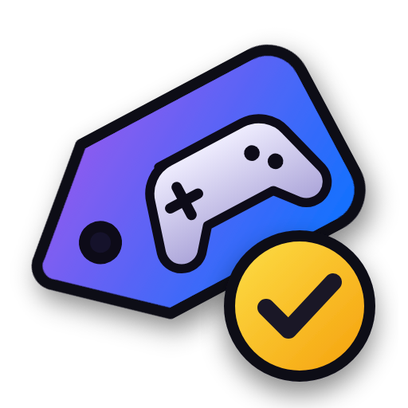

  

<h1 align="center">GameCheck</h1>

  <b>Free games and game sales, posted to Discord by Streamer.bot.</b> 
  One Discord message per topic, edited in place whenever something changes.

  
  
  
  
  
  

  <a href="https://github.com/aaskjer/GameCheck/releases"><b>Download</b></a> &nbsp;·&nbsp;
  <a href="Setup-Guide.md"><b>Setup Guide</b></a> &nbsp;·&nbsp;
  <a href="Import-String.md"><b>Import String</b></a> &nbsp;·&nbsp;
  <a href="CHANGELOG.md"><b>Changelog</b></a>

---

## 📖 Overview

GameCheck brings two Streamer.bot actions together:

- **Free Game Check** keeps one embed each for 🎁 free games, 🧩 free DLC & add-ons, 🎒 free loot, betas and in-game
  items, and 🧪 popular new demos.
- **Game Sale Check** keeps one embed for 🎉 the store-wide sales running now and coming up (Steam's seasonal sales and
  Fests, Epic's and GOG's sales) and one for 💸 the top deals per store, with price, regular price, discount and end.

Both run on their own: they check the stores every hour, update the messages on the minute when a giveaway or a sale
starts or ends, and leave the messages alone when nothing changed.

## ✨ Highlights

- 🏬 **Straight from the stores.** Steam and Epic Games are read directly, with exact end times and prices for your
  country. GOG, Nintendo's European eShop, Prime Gaming and IsThereAnyDeal fill in the rest.
- ✏️ **Edited, not spammed.** Every topic is one message that is edited in place. A new entry is marked 🆕, one that ends
  soon 🔥. Optionally the messages are posted anew every few days, all together and in order.
- 🛟 **Outages don't wipe the list.** A store that fails is replaced by its last good answer for up to 24 hours.
- 🤖 **Bot or webhook.** With a bot the messages can be pinned and older copies cleaned up; a webhook needs no bot at all.
- ⏱️ **No timer to set up.** The trigger "Streamer.bot Started" is enough: every run plans the next one itself.
- 🔒 **Exports without secrets.** Bot token, webhook URL and IsThereAnyDeal key can live in persisted global variables.
- 🎮 **Straight into the launcher.** Optionally, Steam and Epic games open in Steam or the Epic Games Launcher instead
  of the browser.
- 🪟 **A settings window.** Everything is set in one window in the style of the Chat Games; the older Set Argument
  setup keeps working.

---

## Credits

- **Author:** [aaskjer on Twitch](https://twitch.tv/aaskjer) · [aaskjer.github.io](https://aaskjer.github.io/)
- **Built for:** [Streamer.bot](https://streamer.bot) by [nate1280](https://www.patreon.com/c/nate1280/home)
- **Data & services:**
  - [GamerPower](https://www.gamerpower.com): giveaways the stores don't list themselves
  - [IsThereAnyDeal](https://isthereanydeal.com): giveaways, deals of other shops and lowest prices (with your own key)
  - [LootScraper](https://github.com/eikowagenknecht/lootscraper) by Eiko Wagenknecht: Prime Gaming offers
- **Thanks:** YOU ♡

Steam, Epic Games, GOG, Nintendo, Prime Gaming and all store and game names are trademarks of their owners. None of them
is affiliated with or endorses GameCheck.
