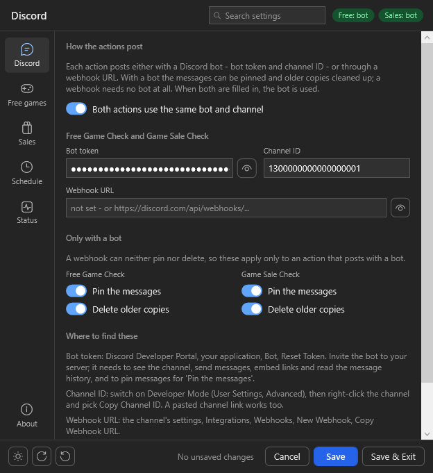
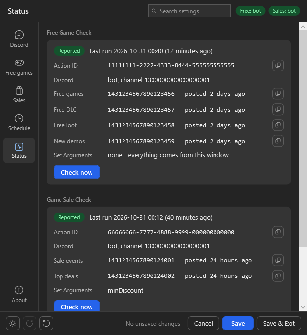

# Setup

GameCheck is three Streamer.bot actions:

| Action | What it does | Script |
|---|---|---|
| `Free Game Check` | the free games, DLC, loot and demos messages | `freegamecheck.cs` |
| `Game Sale Check` | the sale events and top deals messages | `gamesalecheck.cs` |
| `[CG] - Settings` | the settings window for both | `gamecheck-settings.cs` |

## Import

Click `Import` in [Streamer.bot](https://streamer.bot/) and drag the `GameCheck.sb` file from the
[releases](https://github.com/aaskjer/GameCheck/releases) into the window, or paste the
[import string](Import-String.md) instead. Click `Import`, then `Yes` on the popups that follow.

The three actions land in the group `GameCheck`, with their triggers already set: the two checks start with
Streamer.bot (`Streamer.bot Started`), the settings window opens from its `Test` trigger. Nothing is posted until
Discord is set up in the window, so go on with [1. Discord](#1-discord) and [4. First start](#4-first-start).
Steps 2 and 3 are only for setting the actions up by hand.

**Already running Free Game Check or Game Sale Check?** Do not import over them: the import would add a second copy
of both, and two copies post twice. Paste the new scripts into your existing actions as in step 2 and add only the
settings action as in step 3 (see also [Coming from Set Arguments](#coming-from-set-arguments)).

## 1. Discord

Each action posts either with a **bot** or through a **webhook**. A bot can pin its messages and clean up older
copies; a webhook needs no bot at all. One bot and one channel for both actions is the usual setup.

**Bot**

1. Open the [Discord Developer Portal](https://discord.com/developers/applications), click `New Application`, then
   `Bot` → `Reset Token` and copy the token.
2. Under `OAuth2` → `URL Generator` tick `bot`, then the permissions `View Channels`, `Send Messages`, `Embed Links`
   and `Read Message History`, plus `Pin Messages` if the messages should be pinned. Open the generated URL and
   invite the bot to your server.
3. In Discord, switch on `User Settings` → `Advanced` → `Developer Mode`, right-click the channel and choose
   `Copy Channel ID`.

**Webhook**

In the channel's settings: `Integrations` → `Webhooks` → `New Webhook` → `Copy Webhook URL`.

## 2. The two actions (by hand)

The scripts are inside the import; the release has them as files too. Do this once for `Free Game Check` with `freegamecheck.cs` and once for `Game Sale Check` with
`gamesalecheck.cs`:

1. In Streamer.bot, open `Actions`, right-click the action list, choose `Add` and enter the name.
2. Right-click `Sub-Actions` → `Core` → `C#` → `Execute C# Code`. Replace the code in the editor with the whole
   script.
3. Click `Find Refs`, then `Save and Compile`. It has to compile without errors. The references it needs are
   `mscorlib.dll`, `System.dll`, `System.Net.Http.dll`, `System.Runtime.Serialization.dll`, `System.Text.Json.dll`,
   `System.Reflection.Metadata.dll` and `Newtonsoft.Json.dll`.
4. Right-click `Triggers` → `Core` → `System` → `Streamer.bot Started`. That is the only trigger it needs: from
   then on every run plans the next one itself. Add `Core` → `Test` as well if you want to start a check by hand.

No `Set Argument` sub-actions are needed. The settings come from the window.

## 3. The settings window (by hand)

1. Add an action `[CG] - Settings` and give it an `Execute C# Code` sub-action with `gamecheck-settings.cs`.
2. It needs these eight references: `mscorlib.dll`, `System.dll`, `System.Core.dll`, `System.Net.Http.dll`,
   `Newtonsoft.Json.dll`, `PresentationFramework.dll`, `PresentationCore.dll` and `WindowsBase.dll`. `Find Refs`
   adds most of them; add a missing one in the editor's `References` tab (right-click → `Add reference from
   file...`). Then `Save and Compile`.
3. Add the trigger `Core` → `Test`. Right-click it and choose `Test Trigger`: the settings window opens.

## 4. First start

1. **Discord:** bot token and channel ID, or a webhook URL. With *Both actions use the same bot and channel*
   switched on, one set of fields serves both.
2. **Free games** and **Sales:** what is posted, your country, the platforms to leave out, the colours. An
   [IsThereAnyDeal API key](https://isthereanydeal.com/apps/my/) is optional and adds more shops.
3. **Schedule:** how often the stores are read (every 60 minutes unless you change it) and whether the messages
   are posted anew every few days.
4. `Save`, then open **Status** and click `Check now` for each action, or restart Streamer.bot. The messages appear in
   the channel within a minute.

`Ctrl+1` … `Ctrl+6` switch pages, `Ctrl+F` searches all settings, by their label or their argument name.

## Coming from Set Arguments

Older installs set the actions up with `Set Argument` sub-actions. They keep working, and a `Set Argument` value always
wins over the window: the window shows such a setting greyed out, with the name of the action that holds it.

Paste the new scripts into both actions first and let each run once (`Check now`, or a restart): that is how the window
learns their values. The first time it opens it takes them all over, so a first `Save` changes nothing. After that,
delete or disable the `Set Argument` sub-actions in both actions and manage everything in the window. A timer trigger left
over from older versions can go too; the actions plan their own runs once `Streamer.bot Started` is their trigger.

## Open in the launcher

*Open Steam and Epic games in their launcher* (on **Free games**) and *Open Steam and Epic deals in their launcher*
(on **Sales**) make the game links open in Steam or the Epic Games Launcher instead of the browser. Discord only
opens web links, so the link goes through a small page on [aaskjer.github.io](https://aaskjer.github.io/go/) that
hands it on. The first time, your browser asks whether it may open Steam or Epic; tick *Always allow* to skip the
question from then on. If no launcher is installed, the page offers the store's web page instead.

## Where things are kept

- The settings: `GameCheck\GameCheck-Settings.json` in the Streamer.bot folder, written only by the window. The
  previous version is kept beside it as `.bak`.
- Bot token, webhook URL and IsThereAnyDeal key: only in persisted global variables (`FreeGameCheck_botToken`,
  `GameSaleCheck_botToken`, …), never in the file. An export of the actions carries no secrets.
- What the actions remember (message ids, what was new when): the global variables `checkFreeGames` and
  `checkGameSales`.

## When something does not work

- **Nothing is posted:** open Streamer.bot's log and look for lines starting with `[FreeGames]` or `[GameSales]`.
  They say which store failed, or that the bot token or channel is missing.
- **The script does not compile:** compare its references with the lists above.
- **The window does not open:** only one window can be open at a time; look in the log for `[GameCheck/Settings]`.
